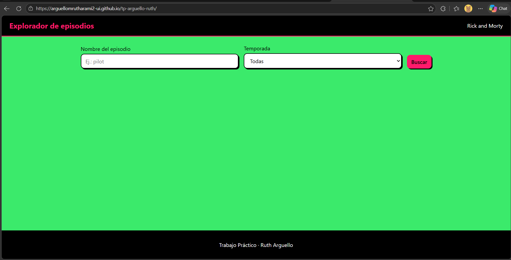

# Explorador de episodios · Rick and Morty

- **Autor/a:** Ruth Arguello
- **Variante:** C · Episodios (último dígito de cédula: 8)
## Sitios publicados
- GitHub Pages: https://arguellomrutharami2-ui.github.io/tp-arguello-ruth/
- Vercel / Netlify: https://tp-arguello-ruth.vercel.app/

## Descripción
Página de una sola pantalla que busca episodios en la API de Rick and Morty por nombre y temporada, y los muestra en tarjetas con nombre, código, fecha de emisión y cantidad de personajes. Recuerda la última búsqueda con localStorage.

## Captura

## Tecnologías
- HTML5, CSS3, JavaScript (ES6+), Fetch API, localStorage, API de Rick and Morty.

## Estructura del proyecto
- `index.html`: estructura de la página y el buscador.
- `css/estilos.css`: estilos, variables y grilla de tarjetas.
- `js/app.js`: lógica de búsqueda, tarjetas y persistencia.
- `img/captura.png`: captura usada en este README.

## Cómo ejecutarlo localmente
1. `git clone https://github.com/arguellomrutharami2-ui/tp-arguello-ruth.git`
2. Abrir `index.html` en el navegador (o con Live Server).

## Despliegue
Se publica la rama `main` en GitHub Pages y en Vercel/Netlify. Cada cambio subido a `main` actualiza ambos sitios automáticamente.
